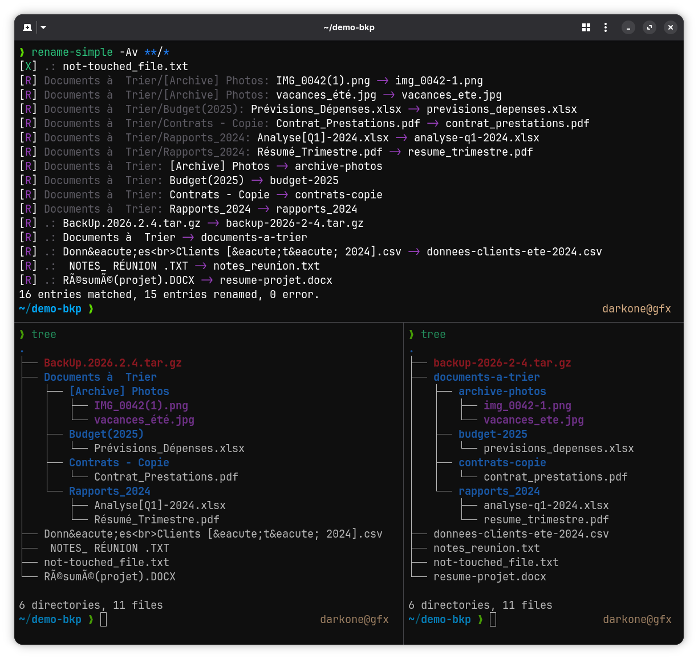

# rename-simple

[](https://github.com/darkone-linux/rename-simple/actions/workflows/ci.yml)
[](https://rust-lang.org)
[](https://crates.io/crates/rename-simple)
[](./LICENSE)

A command-line tool that renames files and directories to clean, ASCII-safe
slugs.



## What it does

- Transliterates accented and extended Latin characters to ASCII (`é → e`, `ç → c`, `œ → oe`, `ß → ss`…)
- Expands typographic ligatures and compatibility forms (`fi → fi`, fullwidth `Ｆｉｌｅ → file`, superscripts `² → 2`, `™ → tm`, `№ → no`)
- Romanises Greek and Cyrillic letters (`Ελληνικά → ellinika`, `Москва → moskva`)
- Lowercases everything
- Replaces spaces and special characters with `-`; collapses consecutive separators
- Preserves `_`; cleans up `_-` and `-_` sequences to `_`
- Strips leading and trailing `-` / `_` before the extension
- Preserves known compound extensions (`.tar.gz`, `.tar.bz2`, `.tar.xz`, `.tar.zst`)
- Keeps extensions separate only when they are ASCII alphanumeric and ≤10 characters
  (`.tét` is absorbed as `-tet`, `.abcdefghijkl` as `-abcdefghijkl`)
- Skips hidden files (`.gitignore`, `.DS_Store`…) and reports naming conflicts
- Reports names that are not valid UTF-8 as errors and leaves them unchanged
- Optionally (`-D`) deletes a source file when the existing target is a byte-for-byte duplicate with the same owner, group and permissions
- Optional cleanup fixes: repairs mojibake (`-U`), strips HTML tags and entities (`-H`), or both (`-A`)

## Installation

Requires [Rust](https://www.rust-lang.org/tools/install) 1.85+.

```bash
# From crates.io
cargo install --locked rename-simple

# Or from source
cargo install --locked --path .
```

`--locked` builds with the dependency versions of `Cargo.lock`, the ones the
release was tested and audited with.

### Prebuilt binary

Each [GitHub release](https://github.com/darkone-linux/rename-simple/releases)
provides a statically linked x86_64 Linux binary, `rename-simple`, and a Debian
package that installs it with its man page:

```bash
sudo apt install ./rename-simple_*_amd64.deb
```

### With Nix

The repository is a flake, so no Rust toolchain is needed:

```bash
# Run without installing
nix run github:darkone-linux/rename-simple

# Or install into your profile
nix profile install github:darkone-linux/rename-simple
```

## Usage

```
rename-simple [OPTIONS] [files]...
```

Each argument is renamed itself, like with `rename`(1). Globbing is left to the
shell: `rename-simple *.jpg`, or `rename-simple dir/**/*.pdf` with zsh or bash
`globstar`. An entry named several times, by overlapping globs or as `x` and
`./x`, is handled once. When a directory and entries inside it are both given,
the entries inside are renamed first. `.`, `..` and `/` are refused; `dir/.`
stands for `dir`. Files and directories are both renamed by default; `-f` /
`-d` restrict renaming to one type. Without arguments, `rename-simple` prints
its help.

A file name starting with `-` that a glob passes on, such as `-D`, would be
read as an option: an option that is also the name of an existing entry makes
the command line invalid. Put `--` before the file names
(`rename-simple -n -- *`), or glob with `./*` (`rename-simple ./*`).

| Option | Description |
|---|---|
| `[files]...` | Entries to rename (files and/or directories) |
| `-f`, `--files-only` | Rename files only |
| `-d`, `--dirs-only` | Rename directories only |
| `-U`, `--fix-unicode` | Repair mojibake (UTF-8 misread as Latin-1/CP1252) before renaming |
| `-H`, `--fix-html` | Strip HTML tags and decode HTML entities before renaming |
| `-A`, `--fix-all` | Apply every cleanup fix: `-U` and `-H` |
| `-D`, `--delete-duplicates` | Delete a source that is a byte-for-byte duplicate of an existing target |
| `-n`, `--dry-run` | Show what would be done without renaming or deleting anything |
| `-q`, `--quiet` | Print nothing, not even errors (the exit status still reports them) |
| `-v`, `--verbose` | Also list unchanged entries (`[X]`) |
| `-h`, `--help` | Print help |
| `-V`, `--version` | Print version |

Renamed entries are printed as `[R]` lines on standard output, deleted
duplicates (`[W]`) and errors (`[E]`) on standard error, followed by a summary
line. Marks are coloured when the output is a terminal. Control and bidirectional formatting characters in names are printed
escaped (`\n`, `\u{1b}`, `\u{202e}`): a name cannot drive the terminal or add a
line to the report. Output that cannot be written, for example once the reader
of a pipe has exited (`| head`), is dropped and every entry is still
processed.

The exit status is `0` when every entry is handled, and `1` when at least one
fails (an `[E]` line, with `-n` and `-q` too): the other entries are processed
all the same. It is `2` when the command line is invalid (unknown option, `-f`
with `-d`, option that is also the name of an existing entry…), and nothing is
renamed then.

## Examples

### Preview the renames

```bash
$ cd ~/Downloads
$ rename-simple -n *
```

```
[R] .: 01_ Introduction au Projet.PDF -> 01_introduction-au-projet.pdf
[R] .: à faire .tét -> a-faire-tet
[R] .: backup.TAR.GZ -> backup.tar.gz
[R] .: Café Montréal.jpg -> cafe-montreal.jpg
[R] .: notes.cuicuicuicui -> notes-cuicuicuicui
[R] .: Réunion d'équipe (2024).docx -> reunion-d-equipe-2024.docx
6 entries matched, 6 entries would be renamed, 0 error.
```

Run the same command without `-n` to apply the renames.

### Rename one type of entry

```bash
$ rename-simple -f *    # files only, directories are ignored
$ rename-simple -d *    # directories only, files are ignored
```

### Process a whole tree

With zsh, or bash with `shopt -s globstar`:

```bash
$ rename-simple ~/Documents/**/*.pdf
```

### Repair damaged names (mojibake, HTML)

Names from broken downloads or web pages may contain mojibake (UTF-8 read as
Latin-1/CP1252) or HTML markup. The cleanup fixes repair the name before it is
converted:

```bash
$ rename-simple -A *
```

```
[R] .: <b>Été 2024.pdf -> ete-2024.pdf
[R] .: Café Montréal.jpg -> cafe-montreal.jpg
[R] .: Tom &amp; Jerry.mp4 -> tom-jerry.mp4
3 entries matched, 3 entries renamed, 0 error.
```

`-U` only changes a name that decodes entirely, so a correct name (`café.jpg`)
is never altered; double mojibake (`Café`) is repaired too. `-H` decodes
named (`&eacute;`), decimal (`&#233;`) and hexadecimal (`&#xE9;`) entities.
Block tags (`<br>`, `<p>`, `<div>`, `<li>`, `<h1>` to `<h6>`…) become a space
(`data<br>client` → `data-client`); inline tags (`<b>`, `<i>`, `<span>`…) are
removed (`client<b>s` → `clients`). Text between `<` and `>` is a tag only if
each of its attributes takes a value (`<a href="x.html">`), so
`if a<b and c>d.txt` → `if-a-b-and-c-d.txt`. A decoded slash is converted like
any other character (`Report &#47; Final.txt` → `report-final.txt`).

### Conflicts and duplicates

An existing entry is never overwritten. When the new name is taken, the entry
is left unchanged and the error says whether both files hold the same bytes:

```bash
$ rename-simple *
```

```
[E] .: IMG 9572.mov -> File name already exists (identical duplicate, use -D to delete the source)
[E] .: VID 20260819.mp4 -> File name already exists (2 different files)
4 entries matched, 0 entry renamed, 2 errors.
```

With `-D`, a source is deleted when the destination is a distinct regular file
with identical content, compared byte for byte, and the same owner, group and
permissions:

```bash
$ rename-simple -D *
```

```
[W] .: IMG 9572.mov -> Identical duplicate, source deleted
[E] .: VID 20260819.mp4 -> File name already exists (2 different files)
4 entries matched, 0 entry renamed, 1 duplicate deleted, 1 error.
```

`-A` does not imply `-D`, and `-D` with `-n` only announces the deletion. Every
other conflict leaves both entries unchanged: different content, a different
owner, group or permissions, a directory, a symlink on either side, or two
names for the same file (hard links). Arguments that would get the same new
name are all left unchanged.

A name that only changes case is not taken: on a case-insensitive filesystem
(FAT, exFAT, NTFS, APFS), `photo.jpg` designates `Photo.JPG` itself, which is
renamed through a temporary name, `.rename-simple-<pid>`, in the same
directory.

The rename itself refuses to overwrite, atomically, on Linux and macOS. On
Windows, and on filesystems that refuse this atomic rename (NFS, sshfs,
ntfs-3g), the new name is checked and then the entry is renamed, as `mv -n`
does: an entry created by another program between the two steps is
overwritten.

### Verbose output

`-v` also lists the entries left unchanged:

```bash
$ rename-simple -v *
```

```
[X] .: notes.txt
[R] .: Mon Fichier.txt -> mon-fichier.txt
[R] .: Москва -> moskva
3 entries matched, 2 entries renamed, 0 error.
```

## Tips

To rename everything in the current directory, run `rename-simple ./*`: with
the `./` prefix, no name can be read as an option. An alias in `~/.bashrc` or
`~/.zshrc` makes it shorter:

```bash
alias rsa='rename-simple ./*'
```

## Running the tests

```bash
cargo test
```

## License

MIT
